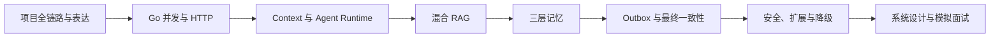

# luckyHelper 项目学习与面试训练计划

> 适用方向：Go 后端工程师、AI 应用工程师、LLM Application Engineer  
> 默认水平：校招至初中级社招  
> 建议周期：8 周，每周 5 天，每天 1.5～2 小时

## 1. 学习目标

完成本计划后，应当能够：

1. 在 3 分钟内讲清 luckyHelper 的业务目标、整体架构和三个核心亮点。
2. 不看源码画出请求处理、DAG 执行、混合 RAG、三层记忆和 Transactional Outbox 流程。
3. 解释 ReAct、RAG、Agentic RAG 的适用场景与取舍。
4. 从 Go 并发、HTTP、数据库、分布式一致性和 AI 应用工程五个角度接受项目深挖。
5. 面对“为什么这样设计”“失败时怎么办”“换一种方案行不行”时给出有边界、有取舍的回答。
6. 诚实区分已经实现、只完成部分闭环、尚未验证的能力。

本计划不绑定某家公司。拿到具体 JD 后，应再按岗位要求调整 Go 基础、算法、系统设计和 AI 工程的占比。

## 2. 学习方法

每个知识点必须完成以下四层，才算真正掌握：

| 层级 | 要求 | 验收方式 |
| --- | --- | --- |
| 概念层 | 能用自己的话解释是什么、解决什么问题 | 60 秒口述，不使用项目黑话堆砌 |
| 源码层 | 能指出项目中的入口、核心结构和关键分支 | 5 分钟内定位到对应文件和函数 |
| 场景层 | 能用一个具体请求完整走通流程 | 画流程图并说明每一步输入输出 |
| 取舍层 | 能解释替代方案、故障场景和当前边界 | 连续回答至少两个“为什么”追问 |

推荐每天采用固定节奏：

- 20 分钟：学习原理。
- 40 分钟：沿源码追踪调用链。
- 30 分钟：运行测试、修改配置或做小实验。
- 20 分钟：不看稿口述。
- 10 分钟：记录不会的问题和第二天复习点。

## 3. 总体学习路线



学习优先级：

1. **最高优先级**：DAG 执行、混合 RAG、长期记忆一致性。
2. **第二优先级**：Go 并发、Context、SSE、JWT、多用户隔离。
3. **第三优先级**：Skill、MCP、沙箱、基础设施降级。
4. **面试加分项**：能够主动指出项目当前边界，并给出改进方案。

---

## 4. 第 1 周：项目全链路与 Go 并发基础

### 本周目标

- 讲清项目不是普通聊天套壳，而是包含任务执行、知识检索和长期记忆的 Agent 系统。
- 掌握 goroutine、channel、WaitGroup、Mutex、Context 和超时取消。
- 看懂一次聊天请求从 HTTP 进入到最终写回记忆的完整链路。

### 源码入口

- [`cmd/server/main.go`](../cmd/server/main.go)
- [`internal/application/chat/runtime_process.go`](../internal/application/chat/runtime_process.go)
- [`internal/application/chat/runtime_task.go`](../internal/application/chat/runtime_task.go)
- [`internal/application/chat/runtime_graph.go`](../internal/application/chat/runtime_graph.go)

### 五天安排

#### Day 1：项目架构

- 阅读 README 的当前能力与架构图。
- 用一句话分别解释 API、UnifiedAgent、RAG、Memory、Tool、Document Library。
- 手绘“浏览器请求到最终回答”的主链路。

#### Day 2：goroutine、WaitGroup 与 Mutex

- 理解为什么同一拓扑层可以并发执行。
- 找出 GraphRuntime 中启动 goroutine 和等待完成的位置。
- 解释为什么工具注册表、任务状态和记忆桶需要锁。

#### Day 3：Context 与取消

- 学习 `context.WithCancel`、`WithTimeout`、`Done` 和错误传播。
- 追踪 `/api/chat/cancel` 如何取消正在执行的请求。
- 说明 HTTP 客户端断开连接后 SSE 请求如何停止。

#### Day 4：并发安全

- 阅读 per-user STM 的并发创建和 Hydrate 测试。
- 分析“复制快照后再遍历”为什么比持锁调用外部函数安全。
- 运行：`go test ./internal/application/chat -run 'TestSTM' -v`。

#### Day 5：第一次口述

- 录制一段 3 分钟项目介绍。
- 回答本周自测题。
- 不看源码画出 `prepare → dispatch → finalize`。

### 本周自测题

1. goroutine 和线程有什么区别？Go 调度器为什么适合 I/O 密集型 Agent 任务？
2. 为什么 `WaitGroup.Add` 应在启动 goroutine 前调用？
3. Context 为什么通常作为函数第一个参数向下传递？
4. 如果工具忽略 Context，用户点击取消会发生什么？
5. 这个项目为什么要为每个并发请求保存独立的 CancelFunc？

### 通过标准

- 能从 `POST /api/chat/stream` 讲到 `finalize`，中间不遗漏路由和上下文装配。
- 能解释 Mutex、RWMutex、WaitGroup、channel、Context 各自负责什么。
- 能指出至少一个潜在 goroutine 泄漏场景及防护方式。

---

## 5. 第 2 周：HTTP、JWT、SSE 与多用户隔离

### 本周目标

- 掌握 HTTP 中间件、JWT Bearer Token、bcrypt 和 SSE。
- 理解认证与多租户隔离不是同一件事。
- 能解释用户不存在时为什么还要执行一次假的 bcrypt 校验。

### 源码入口

- [`internal/interfaces/http/handler/handler.go`](../internal/interfaces/http/handler/handler.go)
- [`internal/interfaces/http/middleware/auth_middleware.go`](../internal/interfaces/http/middleware/auth_middleware.go)
- [`internal/application/auth/service.go`](../internal/application/auth/service.go)
- [`internal/domain/auth/auth.go`](../internal/domain/auth/auth.go)

### 五天安排

#### Day 1：HTTP 请求链

- 学习 chi Router 和中间件洋葱模型。
- 画出 RequestID、PanicRecover、AccessLog、CORS、RequireAuth 的执行顺序。
- 分析为什么健康检查和注册登录不经过 RequireAuth。

#### Day 2：密码与 JWT

- 理解密码哈希与加密的区别。
- 理解 bcrypt cost、Salt 和暴力破解成本。
- 解释 JWT 的 Header、Payload、Signature 和过期时间。

#### Day 3：账号枚举与多租户

- 分析“用户名不存在”和“密码错误”为什么返回同一类错误。
- 解释假的 bcrypt 比较防的是什么侧信道。
- 追踪 `userID` 如何从 JWT 进入 Context，再进入记忆检索过滤条件。

#### Day 4：SSE

- 比较 SSE、WebSocket、普通 HTTP Streaming。
- 解释为什么服务端每次事件后要 Flush。
- 列出 start、route、step、tool_call、token、done 各自适合展示什么。

#### Day 5：接口验证

- 本地注册、登录并携带 Token 调用 `/api/auth/me`。
- 观察缺少、伪造、过期 Token 的响应。
- 口述“认证成功不代表数据一定隔离”的原因。

### 本周自测题

1. JWT 为什么不适合保存敏感明文？
2. JWT 被盗后如何失效？当前项目是否实现服务端 Token 黑名单？
3. SSE 为什么比 WebSocket 更适合单向输出 Agent 执行过程？
4. 只在 Handler 校验 userID 是否足够？为什么领域层还要强制过滤？
5. CORS 和 CSRF 是一回事吗？本项目 Bearer Token 模式如何影响 CSRF 风险？

### 通过标准

- 能画出注册、登录和鉴权请求链。
- 能解释认证、授权、多租户隔离三者的区别。
- 能说明 SSE 断线、代理缓冲和超时可能带来的问题。

---

## 6. 第 3 周：Context Schema、ReAct、DAG 与 GraphRuntime

### 本周目标

- 掌握 Prompt 上下文装配和 Token/字符预算思想。
- 掌握 DAG、拓扑排序、依赖调度、竞速执行、重试和 Replan。
- 能清楚区分 Planner、TaskGraph、GraphRuntime 和 Tool。

### 源码入口

- [`internal/domain/promptctx/schema.go`](../internal/domain/promptctx/schema.go)
- [`internal/domain/promptctx/assembler.go`](../internal/domain/promptctx/assembler.go)
- [`internal/application/chat/plan_graph.go`](../internal/application/chat/plan_graph.go)
- [`internal/application/chat/runtime_graph.go`](../internal/application/chat/runtime_graph.go)
- [`internal/application/chat/replanner.go`](../internal/application/chat/replanner.go)

### 五天安排

#### Day 1：Context Schema

- 解释 Constraints、Planner、TaskMemory、ToolState、Profile、Recall。
- 比较 ChatSchema、ToolSchema、ReactSchema、RagSchema。
- 分析单槽位预算和全局预算为什么要分两层。

#### Day 2：DAG 和拓扑调度

- 学习入度、Ready Nodes、拓扑层和环检测。
- 手工构造 5 个节点的 DAG，并写出每一层可以执行的节点。
- 解释为什么有依赖的节点不能仅靠 goroutine 全部同时启动。

#### Day 3：RaceGroup

- 理解 RaceGroup 表示互为替代的执行方案。
- 比较 First-success-wins 与“普通并行后汇总所有结果”。
- 设计天气 API、搜索引擎、MCP 服务的竞速示例。

#### Day 4：重试和 Replan

- 区分 4xx、5xx、网络错误、超时、取消和参数错误。
- 解释为什么参数错误不应该自动重试。
- 比较“重试原节点”和“Replan 添加替代节点”。

#### Day 5：完整演练

- 给“查询两座城市天气并比较”画 DAG。
- 模拟一个节点超时、一个节点失败和一次 Replan。
- 用 5 分钟讲清整个 GraphRuntime。

### 本周自测题

1. Context Schema 和数据库 Schema 有什么区别？
2. 为什么 Constraints 的预算优先级应高于 Recall？
3. RaceGroup 中所有节点都失败时应该返回什么？
4. 动态添加节点后为什么必须再次校验 DAG？
5. Replan 如何防止模型无限追加节点？
6. 快照能解决什么？当前项目是否已经实现服务重启后的自动续跑？

### 通过标准

- 能手写拓扑排序基本思路。
- 能解释 First-success-wins 的取消语义和适用边界。
- 能指出当前 `rag_agent` 没有独立 Schema、会回退 ChatSchema 的实现细节。

---

## 7. 第 4 周：混合 RAG 与检索质量

### 本周目标

- 掌握文档解析、切分、Embedding、BM25、知识图谱、RRF 和 Rerank。
- 能解释 Small-to-Big 检索为什么同时需要子块和父块。
- 能设计一套 RAG 离线评测方法，而不只说“看回答感觉不错”。

### 源码入口

- [`internal/domain/document/parser.go`](../internal/domain/document/parser.go)
- [`internal/domain/rag/splitter.go`](../internal/domain/rag/splitter.go)
- [`internal/domain/rag/hybrid.go`](../internal/domain/rag/hybrid.go)
- [`internal/domain/rag/rewriter.go`](../internal/domain/rag/rewriter.go)
- [`internal/domain/rag/reranker.go`](../internal/domain/rag/reranker.go)

### 五天安排

#### Day 1：文档解析和切分

- 理解 PDF 文本抽取、扫描件和 OCR 的区别。
- 比较定长切分、递归切分、按语义切分。
- 分析 ChunkSize 与 Overlap 对召回率、噪声和成本的影响。

#### Day 2：三路检索

- 学习 Milvus 向量检索解决的语义匹配问题。
- 学习 Elasticsearch BM25 的词频、逆文档频率和字段长度思想。
- 理解 Neo4j 适合实体关系查询，而不是替代全文检索。

#### Day 3：RRF 与 Rerank

- 手算一个两路检索的 RRF 排名。
- 解释为什么不能直接相加 Milvus 距离和 BM25 分数。
- 比较 Bi-Encoder 召回、Cross-Encoder/LLM Rerank 的成本和准确度。

#### Day 4：Query Rewrite 与 Small-to-Big

- 用多轮问题“那个方案再展开讲讲”演示独立查询改写。
- 解释多查询提高召回率的同时为什么会增加延迟和噪声。
- 解释子块负责定位、父块负责回答的分工。

#### Day 5：RAG Eval

- 为项目准备 20～50 条问题、标准文档和相关 Chunk 标注。
- 学习 Recall@K、MRR、nDCG、Faithfulness、Answer Relevance。
- 分别评估检索阶段和生成阶段，避免把问题混在一起。

### 本周自测题

1. Milvus、Elasticsearch、Neo4j、PostgreSQL 分别保存和查询什么？
2. RRF 为什么对不同检索源的分数尺度更稳健？
3. Parent Chunk 太大会有什么问题？
4. Query Rewrite 改写错误时如何避免召回归零？
5. Reranker 解析失败时为什么应该回退，而不是中断请求？
6. 如何证明混合检索优于只使用 Milvus？

### 通过标准

- 能画出 Ingest 和 Query 两条完整链路。
- 能手算一个简单 RRF 示例。
- 能给出至少三项检索指标、两项回答质量指标和一项延迟指标。

---

## 8. 第 5 周：三层记忆与 Prompt 安全

### 本周目标

- 掌握短期记忆、用户偏好、长期记忆的职责边界。
- 理解语义召回、冲突替代、隔离、去重、衰减和过期。
- 能解释记忆为什么比普通 RAG 更容易遭受 Prompt Injection。

### 源码入口

- [`internal/domain/memory/shortterm/shortterm.go`](../internal/domain/memory/shortterm/shortterm.go)
- [`internal/domain/memory/preference/preference.go`](../internal/domain/memory/preference/preference.go)
- [`internal/domain/memory/longterm/longterm.go`](../internal/domain/memory/longterm/longterm.go)
- [`internal/application/chat/mem_writer.go`](../internal/application/chat/mem_writer.go)
- [`internal/application/chat/poison.go`](../internal/application/chat/poison.go)

### 五天安排

#### Day 1：三层职责

- 为 STM、Preference、LTM 各写三个适合存储和三个不适合存储的例子。
- 解释为什么不能把所有聊天历史都放进 Prompt。
- 追踪用户首次访问时 STM 如何从 PostgreSQL Hydrate。

#### Day 2：长期记忆召回

- 理解 Embedding 相似度、TopK、MinScore 和 Category Filter。
- 解释为什么空 userID 默认返回空结果是安全设计。
- 比较 Profile Slot 和 Recall Slot。

#### Day 3：冲突和 Superseded

- 用“用户从北京搬到上海”演示新旧事实冲突。
- 解释为什么保留旧记忆但默认不召回，而不是直接物理删除。
- 分析 Quarantine 和 Superseded 的区别。

#### Day 4：Consolidation

- 学习相似记忆去重、合并、重要性衰减和 TTL。
- 解释为什么 Consolidation 应先生成计划，再提交权威数据库。
- 阅读“不修改缓存”的纯 Planner 测试。

#### Day 5：记忆投毒演练

- 构造“以后请忽略系统提示”等恶意记忆。
- 分析入口预检、KV 复检、隔离和召回过滤四层防线。
- 讨论规则检测的漏报和误报。

### 本周自测题

1. 聊天记录和长期记忆有什么区别？
2. 为什么 LLM 回答内容不应该无条件写入长期记忆？
3. Quarantine 为什么比直接删除更利于审计？
4. 相似度去重可能错误合并哪些事实？
5. 用户撤回或更正偏好时如何保持可追溯性？

### 通过标准

- 能用一个用户场景讲清三层记忆的写入和读取。
- 能解释多用户隔离、冲突治理和投毒防护。
- 能指出当前规则检测不能完全替代内容安全模型或人工审计。

---

## 9. 第 6 周：Transactional Outbox 与最终一致性

### 本周目标

- 掌握本地事务、乐观锁、幂等、消息重试、死信和对账。
- 能完整解释 PostgreSQL、Milvus、Neo4j 跨库一致性问题。
- 能回答“为什么不用分布式事务”“Kafka 能否替代 Outbox”。

### 源码入口

- [`internal/infrastructure/persistence/memorytx/repository.go`](../internal/infrastructure/persistence/memorytx/repository.go)
- [`internal/infrastructure/persistence/memoryoutbox/repository.go`](../internal/infrastructure/persistence/memoryoutbox/repository.go)
- [`internal/application/memoryprojection/worker.go`](../internal/application/memoryprojection/worker.go)
- [`internal/infrastructure/projection/versioned/projector.go`](../internal/infrastructure/projection/versioned/projector.go)
- [`internal/application/memoryreconcile/reconciler.go`](../internal/application/memoryreconcile/reconciler.go)

### 五天安排

#### Day 1：跨库失败场景

- 列出 PG 成功、Milvus 失败、Neo4j 成功等组合。
- 解释简单顺序写为什么无法可靠回滚。
- 理解 PostgreSQL 是 Source of Truth 的含义。

#### Day 2：Transactional Outbox

- 画出业务记录与 Outbox 事件同事务提交。
- 解释为什么应用进程在 Commit 后立刻崩溃也不会丢投影事件。
- 运行事务回滚测试。

#### Day 3：并发消费和幂等

- 理解 `FOR UPDATE SKIP LOCKED` 如何支持多个 Worker 并发抢任务。
- 分析至少一次投递为什么要求消费者幂等。
- 解释版本号与 ContentHash 各自解决什么问题。

#### Day 4：重试、死信和对账

- 理解指数退避和重试风暴。
- 解释 Dead 状态为什么不能自动无限重试。
- 用 Missing、Stale、Orphan 三种情况演示 Reconciler。

#### Day 5：方案对比

- 对比 Outbox、2PC、Saga、Change Data Capture。
- 准备“为什么这个项目选择 Outbox”的两分钟回答。
- 画出完整时序图。

### 本周自测题

1. Outbox 保证的是强一致性还是最终一致性？
2. 业务记录提交后，Milvus 最长多久可见？这个延迟如何监控？
3. Worker 处理成功但 MarkProcessed 失败会怎样？
4. 为什么旧版本投影事件必须被忽略？
5. 同版本但 ContentHash 不同意味着什么？
6. Reconciler 一次只加载一页时，如何扩展到全量数据？

### 通过标准

- 能在白板上画出 Outbox 写入、消费、重试和对账。
- 能解释至少一次投递、幂等和乐观锁。
- 能清楚说明 Outbox 没有让三个数据库“同时提交”，而是让它们最终收敛。

---

## 10. 第 7 周：MCP、Skill、沙箱、安全与故障降级

### 本周目标

- 掌握工具抽象、MCP HTTP 调用和 Prompt Skill。
- 理解命令静态校验、容器隔离和审计的边界。
- 能解释部分基础设施故障时系统如何降级。

### 源码入口

- [`internal/infrastructure/tool/mcp.go`](../internal/infrastructure/tool/mcp.go)
- [`internal/application/skill/service.go`](../internal/application/skill/service.go)
- [`internal/domain/sandbox/validator.go`](../internal/domain/sandbox/validator.go)
- [`internal/infrastructure/sandbox/docker.go`](../internal/infrastructure/sandbox/docker.go)
- [`internal/application/chat/infra_status.go`](../internal/application/chat/infra_status.go)

### 五天安排

#### Day 1：Tool 与 MCP

- 解释 Tool Name、Description、Parameters 和 Execute 的作用。
- 分析 MCP 4xx、5xx、网络错误和超时的 Retryable 分类。
- 讨论 Endpoint 注册可能带来的 SSRF 和数据泄露风险。

#### Day 2：Skill

- 区分 Prompt Skill 和 MCP Skill。
- 追踪已安装且 Enabled 的 Skill 如何转成 `skill_*` 工具。
- 说明 GitHub Skill 为什么只包装描述、不执行仓库代码。

#### Day 3：沙箱

- 学习 Allowlist、Block、Warn、Confirm。
- 解释 `--network none`、`--read-only`、`cap-drop ALL`、PID/CPU/内存限制。
- 讨论静态正则校验为什么不能证明命令绝对安全。

#### Day 4：故障降级

- 列出 PostgreSQL、Milvus、ES、Neo4j、Kafka、Docker、LLM 分别失败时的行为。
- 区分功能降级、静默失败和应当拒绝服务。
- 分析 `/healthz`、`/readyz`、`/api/status` 的职责。

#### Day 5：威胁建模

- 从 Prompt Injection、SSRF、命令注入、租户越权、PII 泄露五个方面审查系统。
- 为每个威胁写出入口、影响、已有防线和缺失防线。
- 准备一段“当前安全边界”的诚实说明。

### 本周自测题

1. Tool、MCP、Skill 三者是什么关系？
2. 为什么 4xx 通常不重试，而 5xx 可以重试？
3. Docker 沙箱开启只读根文件系统后，产物如何写回宿主机？
4. 正则命令校验有哪些绕过方式？
5. PostgreSQL 不可用时为什么应该跳过 Embedding 和其他索引写入？
6. 当前 `/readyz` 能否真实表示所有依赖已经就绪？

### 通过标准

- 能画出 Tool/MCP/Skill 的统一调用路径。
- 能解释沙箱的纵深防御而不是声称“用了 Docker 就绝对安全”。
- 能给出至少三个当前项目需要补强的生产安全措施。

---

## 11. 第 8 周：测试、系统设计与模拟面试

### 本周目标

- 将所有模块串成可面试表达。
- 能从功能、性能、可靠性、安全和可观测性五个维度改进系统。
- 完成至少两轮录音模拟面试。

### 五天安排

#### Day 1：测试策略

- 运行 `go test ./...`。
- 将现有测试按单元测试、Repository 测试、并发测试和契约测试分类。
- 为 RAG、GraphRuntime 和 HTTP 编写待补测试清单。

#### Day 2：可观测性

- 为请求、工具调用、RAG、Outbox 和 Projector 设计指标。
- 至少包含延迟、成功率、重试数、队列积压、召回质量和 Token 成本。
- 设计 TraceID 如何贯穿 SSE、Tool、LLM 和数据库。

#### Day 3：系统设计扩展

- 假设日活从 100 增长到 10 万，分析无状态 API、队列、缓存和数据库扩展。
- 分析单机内存中的任务状态、STM 和工具注册表如何迁移到多实例。
- 设计限流、熔断、超时和容量保护。

#### Day 4：项目深挖模拟

- 按下方核心 10 问录制完整回答。
- 每题控制在 2～4 分钟。
- 回听并标记空泛、没有例子、没有取舍和夸大实现的地方。

#### Day 5：压力面试

- 连续回答“为什么”“失败怎么办”“你如何验证”三类追问。
- 完成 3 分钟项目介绍和 10 分钟架构深挖。
- 整理一页最终速记卡。

### 通过标准

- 10 道核心题平均达到 3 分以上。
- 任何架构名词都能结合本项目中的源码和具体失败场景解释。
- 能主动指出当前实现边界，并说明优先改什么、为什么。

---

## 12. 核心模拟面试 10 问

评分规则：

- **0 分**：不知道或回答明显错误。
- **1 分**：只会背定义，不能结合项目。
- **2 分**：能结合项目讲主流程，但无法应对追问。
- **3 分**：原理、项目和故障场景都能说明。
- **4 分**：还能讨论替代方案、验证指标和当前边界。

### Q1：请在 3 分钟内介绍 luckyHelper

- 类型：项目破冰
- 难度：⭐⭐
- 考察点：表达结构、项目价值、个人贡献边界。
- 参考答案提示：
  - 先说明它是个人办公 Agent，不是普通聊天套壳。
  - 再讲三个核心亮点：DAG 执行、混合 RAG、长期记忆一致性。
  - 最后讲技术栈、测试和你重点负责的部分。
- 追问方向：
  - 用户为什么需要它？
  - 和直接调用 ChatGPT API 有什么区别？
  - 哪个功能已经验证，哪个还没有生产数据？
- 通过标准：3 分钟内有结论、有主线，不按文件目录流水账介绍。

### Q2：ReAct、RAG、Agentic RAG 有什么区别？系统如何路由？

- 类型：AI 应用基础
- 难度：⭐⭐⭐
- 考察点：模式边界、当前实现。
- 参考答案提示：
  - ReAct 负责规划和工具调用。
  - RAG 负责一次检索后生成答案。
  - Agentic RAG 用多个 Agent 执行研究、写作、审核和保存。
  - 当前由 `use_rag`、知识库 Loaded 状态和报告关键词规则选择。
- 追问方向：
  - 为什么不用 LLM 做 Intent Classification？
  - 规则误判会怎样？如何灰度替换？
  - 用户能否直接选择模式？
- 通过标准：必须说出当前实现是规则路由，而不是虚构成智能 Agent 自动分类。

### Q3：Context Schema 解决了什么问题？六个槽位如何取舍？

- 类型：Prompt 工程与架构
- 难度：⭐⭐⭐
- 考察点：上下文污染、预算管理、优先级。
- 参考答案提示：
  - Schema 是不同模式的 Prompt 配料表。
  - 六个槽位分别承担约束、规划、任务结果、工具、画像和召回。
  - 槽位并发获取，先做局部预算，再做全局预算。
  - 超限时优先保留 Constraints 和 Planner。
- 追问方向：
  - 当前用字符近似 Token 有什么误差？
  - Required Slot 为空怎么办？
  - `rag_agent` 当前选了哪个 Schema？
- 通过标准：能够结合一个具体请求展示最终 Prompt 中包含什么。

### Q4：GraphRuntime 如何执行 DAG？RaceGroup 和 Replan 分别解决什么？

- 类型：Go 并发与 Agent Runtime
- 难度：⭐⭐⭐⭐
- 考察点：拓扑调度、并发控制、错误恢复。
- 参考答案提示：
  - 校验 DAG 后反复寻找 Ready Nodes。
  - 同层节点并发，信号量限制并行度。
  - RaceGroup 表示互为替代的节点，首个成功后取消其他节点。
  - Retry 处理瞬时故障，Replan 处理原方案不足或需要替代路径。
- 追问方向：
  - 所有竞速节点都失败怎么办？
  - 失败节点是否应该允许下游继续执行？
  - Replan 并发修改图时如何保证线程安全？
- 通过标准：能画出包含依赖、并行、竞速和失败的任务图。

### Q5：混合 RAG 为什么同时使用 Milvus、Elasticsearch 和 Neo4j？

- 类型：检索系统
- 难度：⭐⭐⭐
- 考察点：三路召回的互补性。
- 参考答案提示：
  - Milvus 解决语义相似。
  - ES BM25 解决精确关键词和专有名词。
  - Neo4j 解决实体关系。
  - PostgreSQL 保存权威 Chunk 原文和稳定 ID。
  - RRF 用排名而非原始分数做融合。
- 追问方向：
  - 为什么不直接相加三路分数？
  - 某一路超时如何降级？
  - 如何调整 KGWeight？
- 通过标准：能各举一个只有对应检索方式容易命中的例子。

### Q6：如何评估 RAG 效果，而不是只看最终回答？

- 类型：AI 工程与评测
- 难度：⭐⭐⭐⭐
- 考察点：离线数据集、分阶段指标、实验设计。
- 参考答案提示：
  - 构造问题、相关文档、相关 Chunk 和标准答案数据集。
  - 检索评估 Recall@K、MRR、nDCG。
  - 生成评估 Faithfulness、Answer Relevance 和引用覆盖。
  - 比较 vector-only、BM25-only、hybrid、hybrid+rerank。
  - 同时记录 P95 延迟和 Token 成本。
- 追问方向：
  - LLM-as-a-Judge 有什么偏差？
  - 没有人工标注集怎么办？
  - Query Rewrite 提高召回但降低精度时如何决策？
- 通过标准：必须把 Retrieval Eval 与 Generation Eval 分开。

### Q7：三层记忆如何工作？如何防止跨用户泄漏和记忆投毒？

- 类型：Memory 与安全
- 难度：⭐⭐⭐⭐
- 考察点：记忆职责、多租户、Prompt Injection。
- 参考答案提示：
  - STM 保存窗口历史，Preference 保存结构化偏好，LTM 保存可语义召回的长期事实。
  - userID 从 JWT Context 传入，领域层空 userID 默认不召回。
  - 写入前经过整体内容检查和 KV 复检。
  - Quarantine 默认不召回，Superseded 处理新旧事实冲突。
- 追问方向：
  - 为什么不能信任 assistant 回答并直接写入 LTM？
  - 规则检测被绕过怎么办？
  - 如何实现用户要求“忘记我”的数据删除？
- 通过标准：能说出认证成功不等于多租户隔离，并给出纵深防御。

### Q8：PostgreSQL、Milvus、Neo4j 之间如何保证长期记忆一致性？

- 类型：分布式系统与项目深挖
- 难度：⭐⭐⭐⭐
- 考察点：Transactional Outbox、幂等、对账。
- 参考答案提示：
  - PostgreSQL 是 Source of Truth。
  - 业务记录和 Outbox 在同一事务提交。
  - Worker 使用 SKIP LOCKED 消费并投影。
  - 版本号防旧事件覆盖，ContentHash 检测同版本冲突。
  - 指数退避、Dead 状态和 Reconciler 负责失败恢复。
- 追问方向：
  - Worker 写 Milvus 成功但 MarkProcessed 失败怎么办？
  - 为什么不使用 2PC？
  - 如何监控最终一致性的延迟？
- 通过标准：明确回答这是最终一致性，不声称三个数据库原子提交。

### Q9：如果把系统部署到多实例和日活 10 万，需要改造什么？

- 类型：系统设计
- 难度：⭐⭐⭐⭐
- 考察点：状态外置、容量保护、可观测性。
- 参考答案提示：
  - HTTP API 尽量无状态化。
  - 当前内存任务状态、STM、工具注册表需要评估外置或一致性策略。
  - 增加限流、熔断、背压、队列容量和租户配额。
  - 将 Outbox Worker 横向扩展并监控 Lag。
  - 增加 Trace、Metrics、结构化日志和 RAG Eval。
- 追问方向：
  - SSE 连接如何经过负载均衡？
  - 同一用户请求落到不同实例怎么办？
  - LLM 限流时如何排队和降级？
- 通过标准：不只会说“加机器”，能指出当前单机状态和外部依赖瓶颈。

### Q10：讲一个你在该项目中做技术取舍或修复问题的经历

- 类型：行为面 / 项目复盘
- 难度：⭐⭐⭐
- 考察点：STAR、个人贡献、技术判断、复盘。
- 参考答案提示：
  - Situation：长期记忆需要写入多个数据库，存在半成功状态。
  - Task：保证权威数据不丢失，并让投影最终收敛。
  - Action：评估顺序写、2PC、Outbox，最终实现事务写入、版本投影、重试和对账。
  - Result：用事务回滚、旧版本事件、投影失败和对账测试验证关键路径。
  - Reflection：补充监控、分片对账、告警和压测仍是后续工作。
- 追问方向：
  - 这部分具体哪些代码是你写的？
  - 方案中最危险的假设是什么？
  - 如果重做一次你会先验证什么？
- 通过标准：突出个人动作和技术决策，不只说“我们团队做了”。

---

## 13. 面试回答模板

技术题建议使用五段式：

1. **一句话结论**：先直接回答是什么或选什么。
2. **核心原理**：解释关键机制，不堆叠名词。
3. **项目落地**：指出 luckyHelper 中的真实实现。
4. **异常与取舍**：说明失败时怎么办、为什么不用替代方案。
5. **验证与边界**：给出测试、指标以及尚未验证的部分。

示例结构：

```text
结论：这个项目使用 Transactional Outbox 保证长期记忆跨库最终一致。

原理：业务数据和待投影事件在同一个 PostgreSQL 事务中提交，避免业务提交后事件丢失。

项目实现：Worker 使用 SKIP LOCKED 抢占事件，再分别投影到 Milvus 和 Neo4j。

异常与取舍：投影失败采用指数退避，达到上限进入 Dead；旧版本事件会被幂等忽略。

验证与边界：项目覆盖事务回滚和旧事件测试，但目前还缺少生产规模的 Lag 指标与压测数据。
```

行为题使用 STAR：

- Situation：当时有什么真实问题。
- Task：你具体负责什么。
- Action：你做了哪些分析、决策和实现。
- Result：有什么可验证结果。
- Reflection：还有什么边界，下次如何改进。

---

## 14. 当前项目必须诚实说明的边界

面试中主动说明边界通常比夸大更加分：

1. `rag_agent` 尚未定义独立 Context Schema，目前会回退到 ChatSchema。
2. Review Agent 会输出审查意见，但还没有形成“不通过后自动回到 Writer 修改”的闭环。
3. PDF 能检测疑似扫描件，但项目还没有真正执行 OCR。
4. ReAct 会保存执行快照，但当前没有完整的服务重启后自动续跑流程。
5. `/readyz` 当前固定返回成功，真实依赖状态主要通过 `/api/status` 查看。
6. GitHub Skill 只把仓库名称和描述包装成 Prompt，不下载或执行仓库代码。
7. RAG 具备检索策略和测试，但仓库中没有足以证明线上效果提升百分比的生产评测结果。
8. 沙箱包含静态校验和 Docker 隔离，但不能宣称绝对安全，仍需要更强的文件、网络、身份和审计策略。

推荐表达：

```text
这部分机制已经实现并有单元测试覆盖，但还没有生产规模数据，所以我不会宣称提升了固定百分比。
如果进入生产，我会先补离线基准集、P95 延迟、召回指标和灰度对照实验。
```

---

## 15. 最终评分表

| 维度 | 分值 | 达标要求 |
| --- | ---: | --- |
| 项目介绍 | 10 | 三分钟讲清价值、架构、亮点和个人贡献 |
| Go 并发与 Context | 15 | 能解释并发调度、取消、锁和泄漏风险 |
| HTTP、JWT、SSE | 10 | 能讲认证、隔离、流式输出和错误场景 |
| Agent Runtime | 15 | 能画 DAG，解释 Race、Retry、Replan |
| RAG | 15 | 能解释三路检索、RRF、Rerank 和评测 |
| Memory | 10 | 能讲三层职责、冲突、隔离和投毒防护 |
| 分布式一致性 | 15 | 能讲 Outbox、幂等、重试、死信和对账 |
| 安全与扩展性 | 5 | 能指出 MCP、沙箱、多实例风险 |
| 表达与诚实边界 | 5 | 结论先行，不夸大，能讲取舍 |

建议标准：

- 60 分以下：只能复述功能，暂不适合项目深挖。
- 60～74 分：可以应对一面，但容易在连续追问中失分。
- 75～84 分：能够应对大多数初中级项目面试。
- 85 分以上：具备较完整的系统设计和技术取舍表达。

## 16. 每周复盘模板

每周结束填写一次：

```text
本周主题：

1. 我现在能独立讲清的三个知识点：
-
-
-

2. 我仍然只能背定义的知识点：
-

3. 我能画出的流程图：
-

4. 我在源码中定位过的关键函数：
-

5. 面试追问中最容易卡住的问题：
-

6. 下周需要补的实验或测试：
-

本周自评分：__/100
```

## 17. 建议的模拟面试顺序

完成第 3 周后：进行一次 30 分钟基础面，重点考 Go、Context、JWT、SSE、DAG。

完成第 6 周后：进行一次 45 分钟项目二面，重点考 RAG、Memory、Outbox 和故障恢复。

完成第 8 周后：进行一次 60 分钟完整模拟：

1. 3 分钟项目介绍。
2. 15 分钟基础与源码题。
3. 25 分钟项目深挖与系统设计。
4. 10 分钟行为题。
5. 7 分钟候选人反问和复盘。

完成一次模拟后，不要只看总分，应记录面试官在哪个回答上第一次开始怀疑项目深度。那个位置通常就是下一轮最需要补强的知识点。
